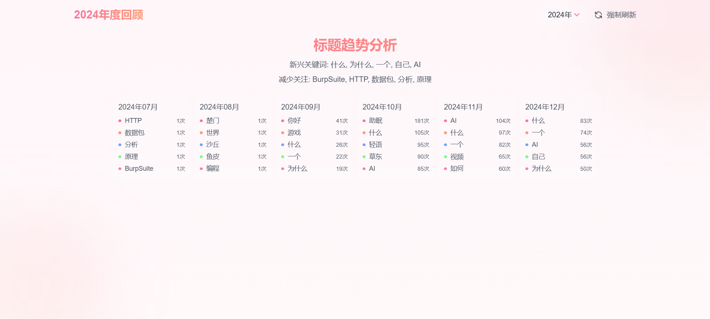

# BilibiliHistoryFrontend

这是一个基于 Vue 3 开发的B站历史记录分析工具的前端项目，为用户提供丰富的B站观看历史数据分析功能。

## 该项目需要配合 [BilibiliHistoryFetcher](https://github.com/LifeArchiveProject/HistoryHub) 后端项目一起使用

## 快速开始

1. 克隆项目
```bash
git clone https://github.com/LifeArchiveProject/BiliHistoryFrontend.git
cd BilibiliHistoryFrontend
```

2. 安装依赖
```bash
npm install
```

3. 启动开发服务器
```bash
# 网页版开发
npm run dev
```

4. 构建应用
```bash
# 网页版构建
npm run build
```

**项目结构**

```
BilibiliHistoryFrontend/
├── src/                    # 源代码目录
│   ├── api/               # API 接口
│   ├── components/        # Vue 组件
│   │   └── tailwind/     # Tailwind 样式组件
│   ├── router/           # 路由配置
│   └── style.css         # 全局样式
├── public/               # 静态资源
└── vite.config.js        # Vite 配置
```

## 首次使用指南

1. **登录账号**
  - 点击侧边栏的设置，然后配置你的服务器地址
  - 然后点击侧边栏中的"未登录"状态
  - 使用B站手机APP扫描二维码进行登录
  - 登录成功后会显示你的用户名

2. **获取历史记录**
  - 登录成功后，点击导航栏中的"实时更新"按钮
  - 首次使用时会自动获取你的全部历史记录，这可能需要一些时间
  - 获取完成后数据会自动导入到本地数据库
  - 页面会自动刷新并显示你的观看历史

3. **后续使用**
  - 每次打开页面时，建议点击"实时更新"以获取最新记录
  - 实时更新只会获取新增的记录，速度很快

## 页面介绍

**1. 主页**


**2. 评论**


**3. 媒体管理**


**4. 计划任务**


**5. 设置**


**6. 视频下载功能**


**7. 年度总结页面**

开场页


年度观看数据


观看时间


重复观看


整体完成率


UP主完成率


标题关键词


月度关键词


**8. 本地摘要功能**

本地摘要功能允许用户在本地生成视频内容摘要，无需依赖B站官方AI摘要：


## 使用 Tauri 构建桌面应用

本项目使用 [Tauri](https://tauri.app/) 构建跨平台桌面应用，相比 Electron 具有更小的体积和更高的性能。

**环境准备**

1. 安装 Rust 开发环境
  - 按照 [Rust 官方指南](https://www.rust-lang.org/tools/install) 安装 Rust
  - Windows 用户还需安装 [Visual Studio C++ 构建工具](https://visualstudio.microsoft.com/visual-cpp-build-tools/)

2. 安装 Node.js 依赖
   ```bash
   npm install
   ```

**开发与构建**

1. 开发模式
   ```bash
   npm run tauri:dev
   ```
   这将启动一个开发服务器，并自动打开应用窗口，支持热重载。

2. 构建可执行文件
   ```bash
   npm run tauri:build:exe
   ```
   构建完成后，将在项目根目录生成 `BiliBili-History-Frontend.exe` 可执行文件。

3. 清理构建文件
   ```bash
   npm run tauri:clean
   ```
   清理 `src-tauri/target` 目录中的构建产物，释放磁盘空间。

### 构建特点

- 小体积：生成的可执行文件约 11MB，远小于 Electron 构建的应用
- 高性能：使用 Rust 后端和系统 WebView，运行更流畅
- 无需安装：生成的是独立可执行文件，无需安装即可使用
- 本地化：所有链接在应用内部打开，提供更好的用户体验

## 贡献指南

欢迎提交 Issue 和 Pull Request 来帮助改进这个项目。

## 许可证

[MIT License](LICENSE)

## 致谢

- [bilibili-API-collect](https://github.com/SocialSisterYi/bilibili-API-collect) - 没有它就没有这个项目
- [Yutto](https://yutto.nyakku.moe/) - 可爱的B站视频下载工具
- [FasterWhisper](https://github.com/SYSTRAN/faster-whisper) - 音频转文字
- [DeepSeek](https://github.com/deepseek-ai/DeepSeek-R1) - DeepSeek AI API
- [ArtPlayer](https://github.com/zhw2590582/ArtPlayer) - 强大且灵活的HTML5视频播放器
- [aicu.cc](https://www.aicu.cc/) - 第三方B站用户评论API
- 所有贡献者

## Star History

[](https://star-history.com/#LifeArchiveProject/BiliHistoryFrontend&Date)
