<div align="center">
  
</div>

这是一个基于 Vue 3 开发的 B 站历史记录分析工具的前端项目，为用户提供丰富的 B 站观看历史数据分析功能。

## 该项目需要配合 [BilibiliHistoryFetcher](https://github.com/LifeArchiveProject/HistoryHub) 后端项目一起使用

## 快速开始

### 使用 Docker 安装

1. 安装[Docker](https://docs.docker.com/get-started/get-docker/).
2. 构建镜像：`docker build -t bili-history-fetcher-web:dev .`
3. 启动容器：`docker run --name bili-history-fetcher-web -p 5173:80 -d bili-history-fetcher-web:dev`
4. 停止容器：`docker stop bili-history-fetcher-web`

### [通过 1Panel 部署](https://github.com/LifeArchiveProject/HistoryHub/discussions/65)
由社区贡献者 [@QYG2297248353](https://github.com/QYG2297248353) 实现 ([#66](https://github.com/LifeArchiveProject/HistoryHub/pull/66))
### 使用源码安装

1. 克隆项目
```bash
git clone https://github.com/LifeArchiveProject/BiliHistoryFrontend.git
cd BilibiliHistoryFrontend
```

2. 安装依赖
```bash
npm install
```

3. 启动开发服务器
```bash
# 网页版开发
npm run dev
```

## 首次使用指南

1. **登录账号**
  - 点击侧边栏的设置，然后配置你的服务器地址
  - 然后点击侧边栏中的"未登录"状态
  - 使用 B 站手机 APP 扫描二维码进行登录
  - 登录成功后会显示你的用户名

2. **获取历史记录**
  - 登录成功后，点击导航栏中的"实时更新"按钮
  - 首次使用时会自动获取你的全部历史记录，这可能需要一些时间
  - 获取完成后数据会自动导入到本地数据库
  - 页面会自动刷新并显示你的观看历史

3. **后续使用**
  - 默认的计划任务会在每天 0 点自动获取历史记录
  - 可去设置里配置邮箱进行通知，不配置不影响自动获取，只是无法收到通知
  - 每次打开页面时，建议点击"实时更新"以获取最新记录
  - 实时更新只会获取新增的记录，速度很快

## 页面介绍

**1. 年度总结页面**

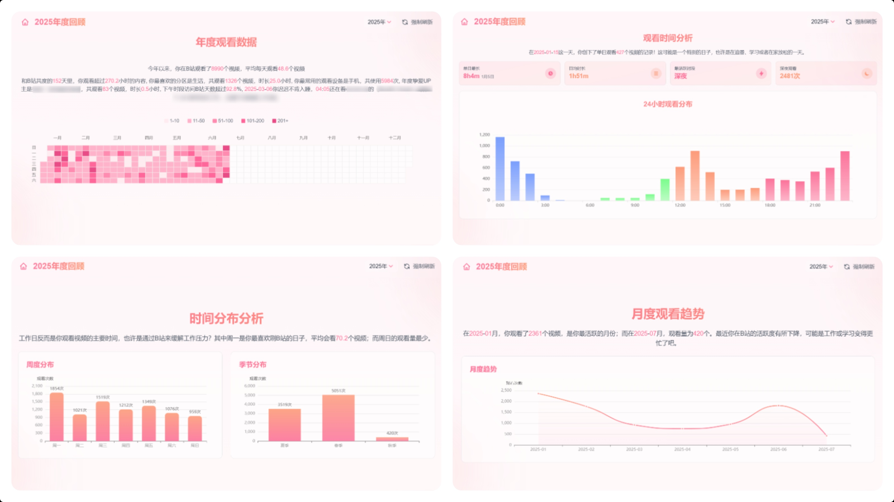
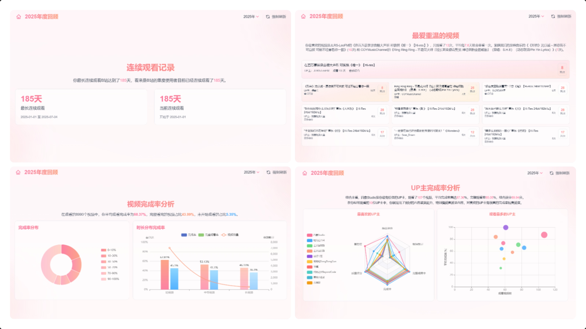
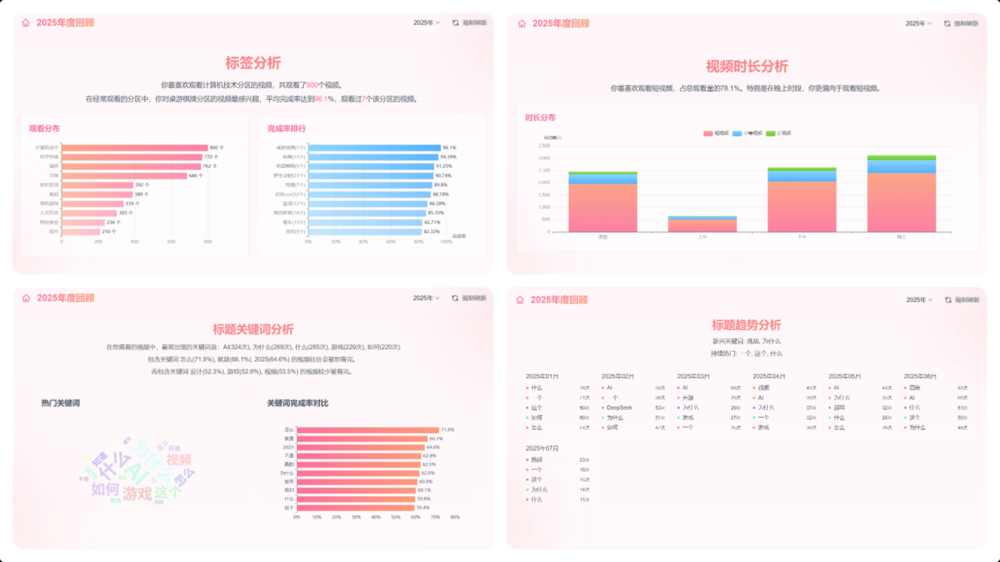
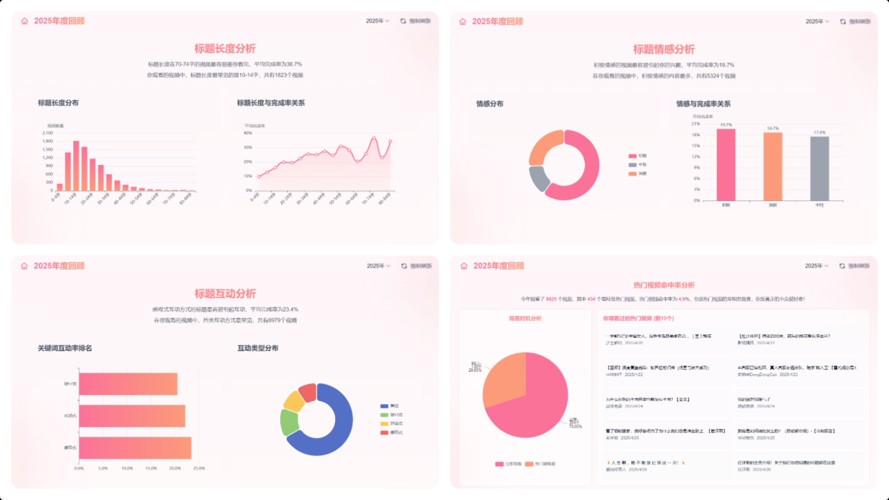
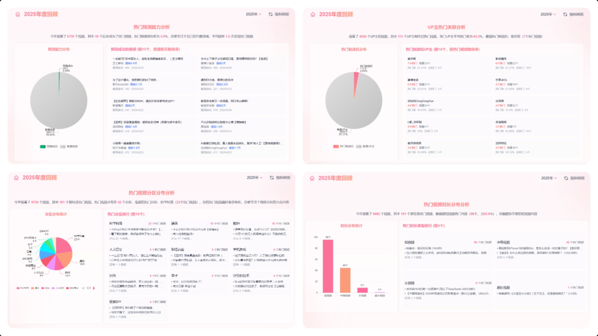

**2. 主页** 支持列表/网格切换与日期、分区筛选，一键实时更新，支持隐私模式。


**3. 评论** 登录后查看我的评论，支持关键词与类型筛选，并可跳转原文。
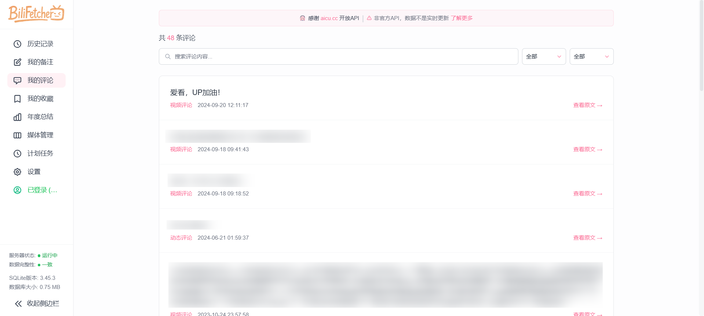

**4. 我的收藏** 支持查看我创建/收藏及本地收藏夹，可同步到本地并下载收藏内容。
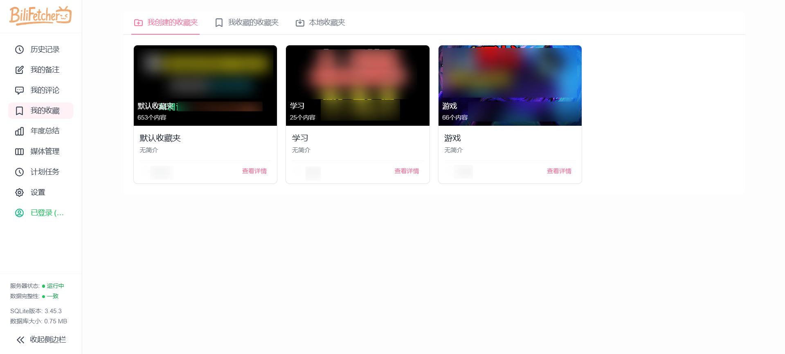

**5. 媒体管理** 集中管理已下载视频与图片，查看/编辑备注与评论，并可批量补全视频详情。


**6. 计划任务** 统一管理定时与链式任务，支持新建/编辑/执行/启用或禁用，并查看历史与成功率。


**7. 设置** 配置服务器、隐私与布局、像素化与像素字体，数据导出。
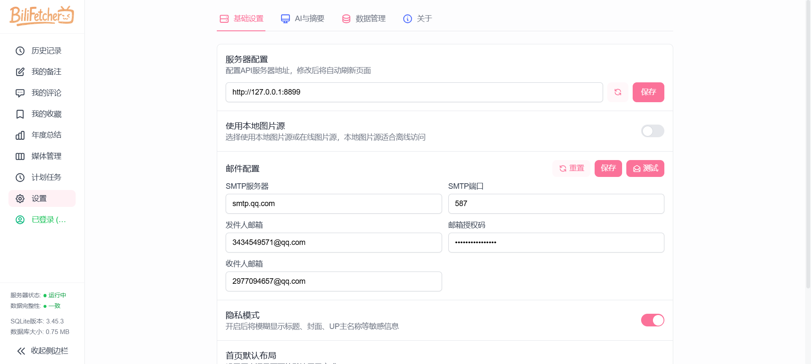

**8. 视频下载功能** 输入 BV/链接或 UP UID 下载单个/合集/投稿，过程实时反馈。

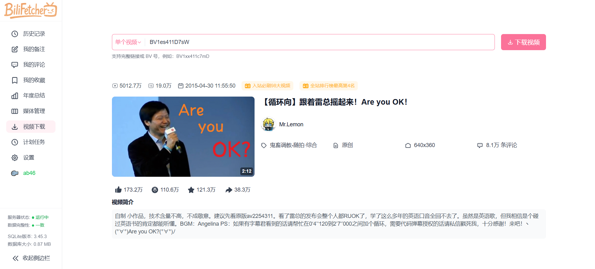


**9. 视频观看总时长** 查询合集级观看总时长、平均时长与完播率，可按列查看统计
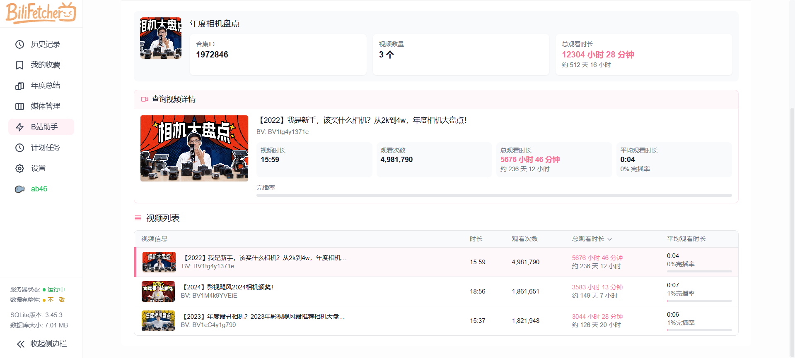

**10. 动态下载** 输入用户MID下载B站动态内容，实时显示下载进度
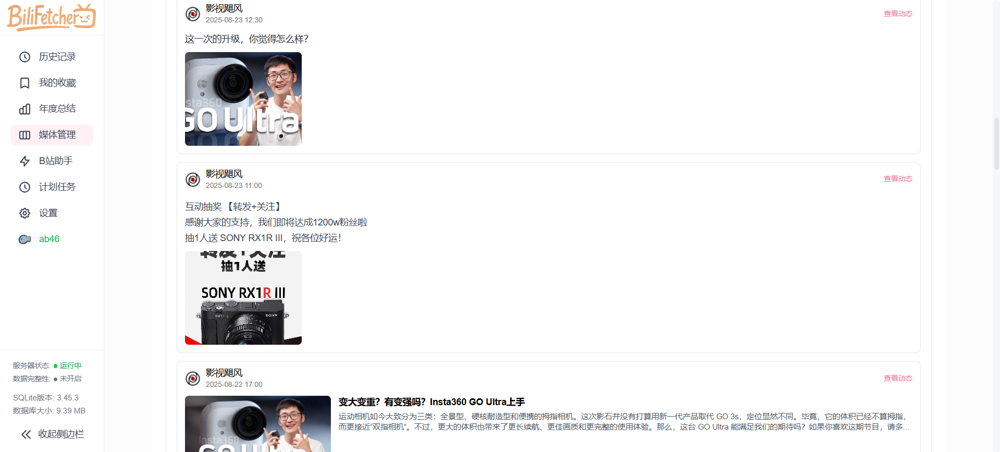

**11. 本地摘要功能** 基于本地语音转文字结合 DeepSeek 生成视频摘要，支持模型管理、环境检测与结果缓存。
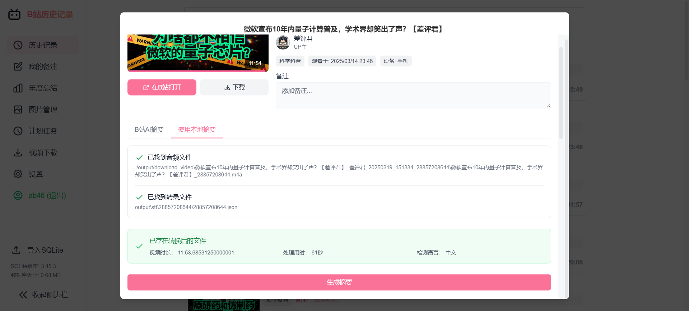
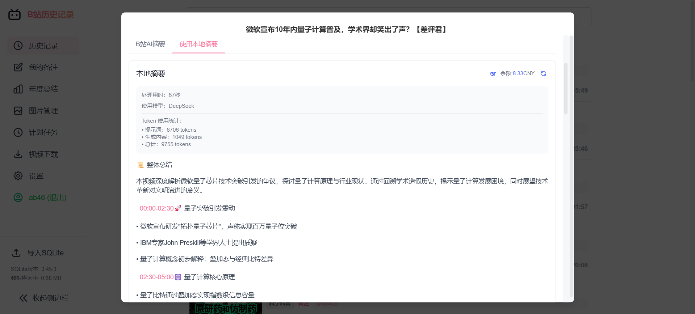

## 使用 Tauri 构建桌面应用

**环境准备**

1. 安装 Rust 开发环境
  - 按照 [Rust 官方指南](https://www.rust-lang.org/tools/install) 安装 Rust
  - Windows 用户还需安装 [Visual Studio C++ 构建工具](https://visualstudio.microsoft.com/visual-cpp-build-tools/)

2. 安装 Node.js 依赖
   ```bash
   npm install
   ```

**开发与构建**

1. 开发模式
   ```bash
   npm run tauri:dev
   ```
   这将启动一个开发服务器，并自动打开应用窗口，支持热重载。

2. 构建可执行文件
   ```bash
   npm run tauri:build:exe
   ```
   构建完成后，将在项目根目录生成 `BiliBili-History-Frontend.exe` 可执行文件。

3. 清理构建文件
   ```bash
   npm run tauri:clean
   ```
   清理 `src-tauri/target` 目录中的构建产物，释放磁盘空间。

## 贡献指南

欢迎提交 Issue 和 Pull Request 来帮助改进这个项目。

## 致谢

- [bilibili-API-collect](https://github.com/SocialSisterYi/bilibili-API-collect) - 没有它就没有这个项目
- [Yutto](https://yutto.nyakku.moe/) - 可爱的 B 站视频下载工具
- [FasterWhisper](https://github.com/SYSTRAN/faster-whisper) - 音频转文字
- [DeepSeek](https://github.com/deepseek-ai/DeepSeek-R1) - DeepSeek AI API
- [ArtPlayer](https://github.com/zhw2590582/ArtPlayer) - 强大且灵活的 HTML5 视频播放器
- [aicu.cc](https://www.aicu.cc/) - 第三方 B 站用户评论 API
- [方舟像素字体](https://github.com/TakWolf/ark-pixel-font) - 开源的泛中日韩像素字体
- [缝合像素字体](https://github.com/TakWolf/fusion-pixel-font) - 混搭风格的像素字体
- [小黑盒用户 shengyI](https://www.xiaoheihe.cn/app/bbs/link/153880174) - 视频观看总时长功能思路提供者
- 所有贡献者，特别感谢:
  - [@eli-yip](https://github.com/eli-yip) 对 Docker 部署的贡献
  - [@QYG2297248353](https://github.com/QYG2297248353) 对 1Panel 部署的贡献

## Star History

[](https://star-history.com/#LifeArchiveProject/BiliHistoryFrontend&Date)
