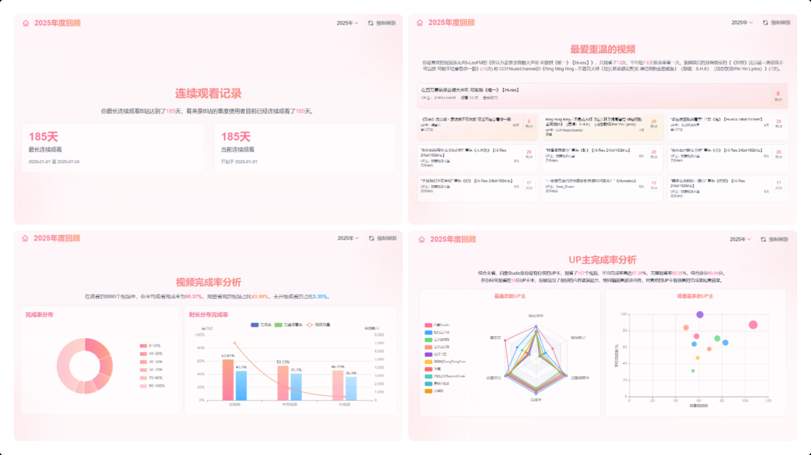
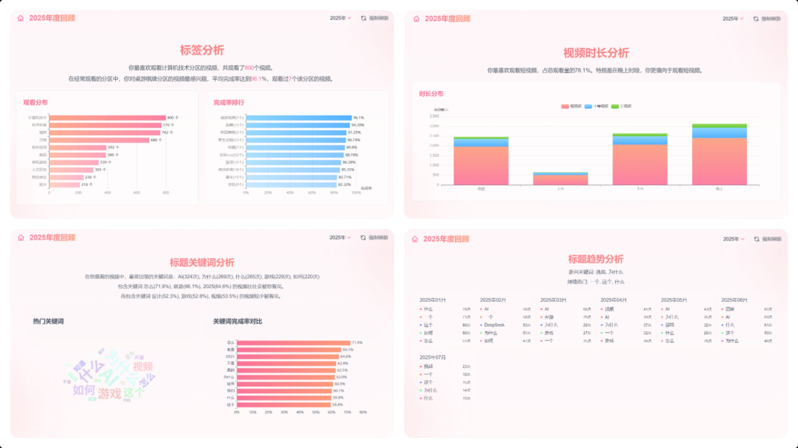
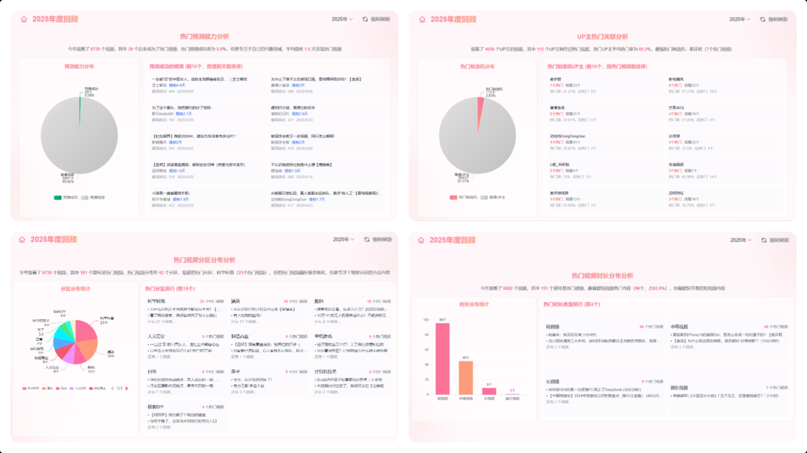
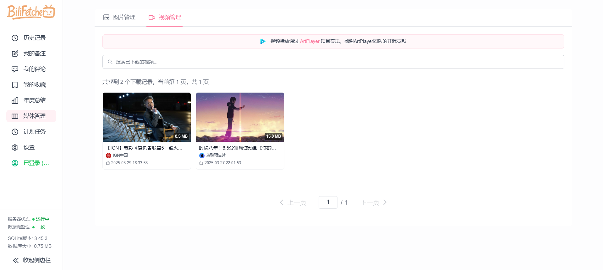
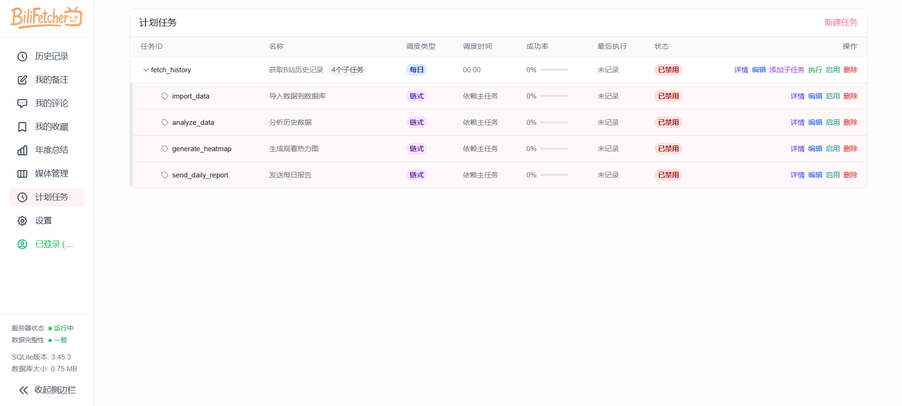
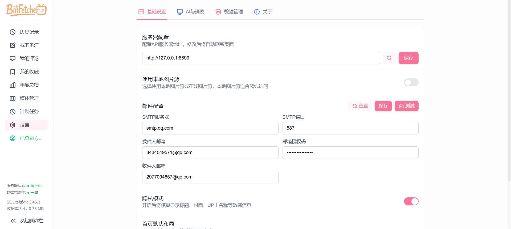
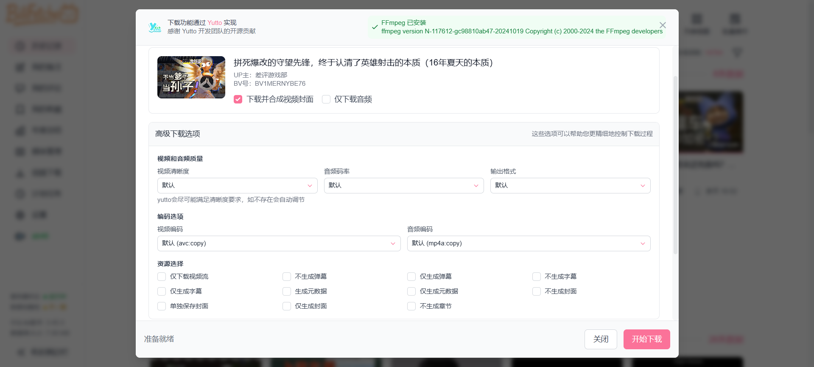

# HistoryHub 前端

基于 Vue 3 的网页与 B 站历史记录管理界面，支持浏览器历史搜索、隐私显示、B 站观看历史分析与媒体管理。

前端位于 [HistoryHub/frontend](https://github.com/LifeArchiveProject/HistoryHub/tree/master/frontend)，与同一仓库的 [HistoryHub 后端](https://github.com/LifeArchiveProject/HistoryHub) 配合使用。

## 快速开始

### 从源码启动前后端

安装 [Docker](https://docs.docker.com/get-started/get-docker/)，然后克隆仓库：

```bash
git clone https://github.com/LifeArchiveProject/HistoryHub.git
cd HistoryHub
```

在仓库根目录的 `config/config.yaml` 中填写 `browser_history.sync_token`，然后构建并启动：

```bash
docker compose up -d --build
```

打开 `http://localhost:5173`。默认后端地址为 `http://localhost:8899`，自托管时可在前端设置中修改。

### 仅构建前端镜像

在 `frontend/` 目录执行：

```bash
docker build -t historyhub-frontend:local .
docker run --name historyhub-frontend-web -p 5173:80 -d historyhub-frontend:local
```

### [通过 1Panel 部署](https://github.com/LifeArchiveProject/HistoryHub/discussions/65)
由社区贡献者 [@QYG2297248353](https://github.com/QYG2297248353) 实现 ([#66](https://github.com/LifeArchiveProject/HistoryHub/pull/66))
### 使用源码安装

1. 克隆项目
```bash
git clone https://github.com/LifeArchiveProject/HistoryHub.git
cd HistoryHub/frontend
```

2. 安装依赖
```bash
npm install
```

3. 启动开发服务器
```bash
# 网页版开发
npm run dev
```

## 首次使用指南

### 网页历史

1. 在后端配置 `HISTORYHUB_SYNC_TOKEN`，或在 `config/config.yaml` 中配置 `browser_history.sync_token`。
2. 将 Chrome 扩展连接到同一个本地或自托管后端，并填写相同密钥，详见[网页历史连接说明](https://github.com/LifeArchiveProject/HistoryHub#网页历史)。
3. 打开侧边栏的“网页历史”，输入连接密钥并点击“保存并连接”。密钥只保存在当前浏览器，并仅随网页历史请求发送。
4. 输入标题或网址进行搜索，滚动到底部加载下一页，每页 50 条；隐私模式会遮蔽标题、域名和访问时间。

网页历史无需登录 B 站。服务器地址在设置页面统一配置。

### B 站历史

1. **登录账号**
  - 点击侧边栏的设置，然后配置你的服务器地址
  - 然后点击侧边栏中的"未登录"状态
  - 使用 B 站手机 APP 扫描二维码进行登录
  - 登录成功后会显示你的用户名

2. **获取历史记录**
  - 登录成功后，点击导航栏中的"实时更新"按钮
  - 首次使用时会自动获取你的全部历史记录，这可能需要一些时间
  - 获取完成后数据会自动导入到本地数据库
  - 页面会自动刷新并显示你的观看历史

3. **后续使用**
  - 默认的计划任务会在每天 0 点自动获取历史记录
  - 可去设置里配置邮箱进行通知，不配置不影响自动获取，只是无法收到通知
  - 每次打开页面时，建议点击"实时更新"以获取最新记录
  - 实时更新只会获取新增的记录，速度很快

## 页面介绍

**1. 年度总结页面**







**2. 主页** 支持列表/网格切换与日期、分区筛选，一键实时更新，支持隐私模式。


**3. 评论** 登录后查看我的评论，支持关键词与类型筛选，并可跳转原文。


**4. 我的收藏** 支持查看我创建/收藏及本地收藏夹，可同步到本地并下载收藏内容。


**5. 媒体管理** 集中管理已下载视频与图片，查看/编辑备注与评论，并可批量补全视频详情。


**6. 计划任务** 统一管理定时与链式任务，支持新建/编辑/执行/启用或禁用，并查看历史与成功率。


**7. 设置** 配置服务器、隐私与布局、数据导出，也可以启用/关闭后端 MCP 只读服务并复制 AI 连接提示词。


**8. 视频下载功能** 输入 BV/链接或 UP UID 下载单个/合集/投稿，过程实时反馈。



**9. 动态下载** 输入用户MID下载B站动态内容，实时显示下载进度


## 使用 Tauri 构建桌面应用

### GitHub Actions 自动构建（多平台包体）

推送 tag（例如 `v1.0.0`）后，会自动在 GitHub Releases 里生成 Windows/macOS/Linux 的安装包与产物。

**环境准备**

1. 安装 Rust 开发环境
  - 按照 [Rust 官方指南](https://www.rust-lang.org/tools/install) 安装 Rust
  - Windows 用户还需安装 [Visual Studio C++ 构建工具](https://visualstudio.microsoft.com/visual-cpp-build-tools/)

2. 安装 Node.js 依赖
   ```bash
   npm install
   ```

**开发与构建**

1. 开发模式
   ```bash
   npm run tauri:dev
   ```
   这将启动一个开发服务器，并自动打开应用窗口，支持热重载。

2. 构建可执行文件
   ```bash
   npm run tauri:build:exe
   ```
   构建完成后，将在 `frontend/` 目录生成 `HistoryHub.exe` 可执行文件。

3. 清理构建文件
   ```bash
   npm run tauri:clean
   ```
   清理 `src-tauri/target` 目录中的构建产物，释放磁盘空间。

## 贡献指南

欢迎提交 Issue 和 Pull Request 来帮助改进这个项目。

## 致谢

- [bilibili-API-collect](https://github.com/SocialSisterYi/bilibili-API-collect) - 没有它就没有这个项目
- [Yutto](https://yutto.nyakku.moe/) - 可爱的 B 站视频下载工具
- [ArtPlayer](https://github.com/zhw2590582/ArtPlayer) - 强大且灵活的 HTML5 视频播放器
- [aicu.cc](https://www.aicu.cc/) - 第三方 B 站用户评论 API
- 所有贡献者，特别感谢:
  - [@eli-yip](https://github.com/eli-yip) 对 Docker 部署的贡献
  - [@QYG2297248353](https://github.com/QYG2297248353) 对 1Panel 部署的贡献

## Star History

[](https://star-history.com/#LifeArchiveProject/HistoryHub&Date)
